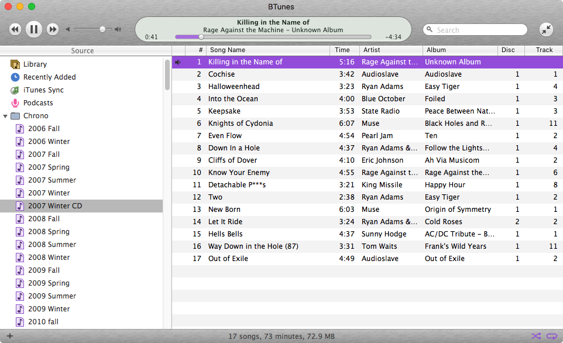
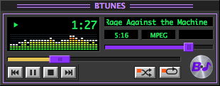

# bTunes

bTunes is a music player for the Mac that looks and works like iTunes circa early 2000s, with a Winamp-style mini mode.





bTunes is not affiliated with or endorsed by Apple, or by whoever owns Winamp these days.  iTunes is a trademark of Apple Inc. and Winamp is a trademark of its owner.  None of their code or artwork is in here.  This is a personal, non-commercial project.

**While bTunes can import (non-protected) music and playlists from iTunes, bTunes never writes to your audio files or to your iTunes library.**

## What this is and why it exists

My iTunes library goes back about 25 years and is primarily organized around playlists.  I can't get my playlists on Spotify, and fuck not owning your music.  One day, this Mac will die, or Apple will turn off its servers.  This has been a simmering problem for a decade.

My media center is a Mac old enough to have a driver's permit; El Capitan is the last OS it will run.

I want all my playlists and metadata from iTunes, with an interface from when iTunes didn't suck, and I want it to run on my media Mac.


## What it does

 - looks like iTunes 4: gray window, search top right, transport top left, readout in between, sources down the left
 - genre / artist / album browser columns across the top of the library
 - smart playlists, built from rules
 - playlist folders (which iTunes 4 didn't have)
 - imports from an iTunes library: songs, ratings, play counts, date added, and playlists
 - mini mode: a small dark panel with a spectrum analyzer that floats over everything, including full screen apps
 - a ten band equalizer
 - plays audio CDs, and rips them to AAC or Apple Lossless
 - burns a playlist to an audio CD, with CD-Text
 - syncs playlists to an iPod


## Requirements

The target is macOS 10.11 El Capitan, so the app is Objective-C against the APIs that system has.  The supported audio formats are the ones its Core Audio decodes: mp3, AAC, Apple Lossless, AIFF, WAV, and CAF.  FLAC and Ogg Vorbis aren't supported.  I'd have to bundle a decoder, and I haven't.

There's no Xcode project and there are no nib files.  The whole interface is built in code, and the build is one clang invocation.  Xcode 8 and a current toolchain disagree about nearly everything else, and Swift 3 is a dead end.  Objective-C and one shell script work on both.

## Building

```
./build.sh              # release build into build/BTunes.app
./build.sh --debug      # unoptimized, with symbols
./build.sh --run        # build, then launch
```

The architecture follows the machine doing the build.  Set `ARCH=x86_64` to force an Intel build.

```
./tools/check-1011.sh   # flags anything newer than the target system
./tools/make-logo.sh    # redraws the artwork in resources/logo
```

Run `check-1011.sh` before handing a build to the Xcode 8 machine.  Enum constants compile away, so those are fine.  Anything else newer than 10.11 (classes, methods, named constants) builds fine on a modern Mac and then crashes on the old one.

## Deploying

I use three machines for this.  One edits and commits.  `BUILD` compiles.  It's the only one with an Xcode old enough to make a binary the target will load.  `TARGET` is the old Mac that plays music, and I only ever run the app there.  (I don't run it on the modern Mac, even to check a change.  Launching fine there says nothing about 10.11.)

```
./tools/deploy.sh                 # copy source to BUILD, compile, install on TARGET, start it
./tools/deploy.sh --no-run        # install it but leave it stopped
./tools/deploy.sh --no-sync       # rebuild what is already on BUILD
./tools/deploy.sh --stop          # stop whatever is running on TARGET
./tools/deploy.sh --applications  # also install into /Applications, and start that copy
```

`--applications` needs passwordless sudo on the target.  If sudo asks for a password, the script skips that step and prints the command for you to run by hand.

Host names live in `env.local.sh`, which isn't tracked.  Copy `env.example.sh` and fill in the two machines:

```
cp env.example.sh env.local.sh
```

The app goes through the editing machine on its way from `BUILD` to `TARGET`, so those two don't need credentials for each other.  Installing replaces only the bundle; the `BTunes Library` folder beside it (ratings, play counts) is left alone.  Any copy already running on `TARGET` is stopped first.  Two copies share one database, and the second one to save overwrites the first.

## Settings

Preferences (Command-comma) has four locations, plus a switch for purple mode (the main window draws in purple instead of blue).

- **Music** is the folder the audio sits in, and the root every track's path is stored against.  A song is stored as its path below this folder.  Point the setting at the same music on another machine and the same library opens there.  A file outside the folder keeps its full path and still works.  Existing libraries convert themselves the first time they load.
- **Library** is where bTunes keeps its own database: ratings, play counts, playlists.  Changing it doesn't move any songs.
- **iTunes** is the library file a sync reads.  I point mine at a copy while I'm testing.
- **Detune** is an optional second music folder, with a `detune-mapping.json` that joins its audio to iTunes entries by persistent id.  Songs from it are recorded by their place below that folder, same as ordinary music is below the music folder.  If you don't have one, leave it empty.

The database is `btunes_library.json`.  With no setting it lives in a `BTunes Library` folder beside the app if there is one, otherwise in `~/Library/Application Support/BTunes`.  `BTUNES_LIBRARY_DIR` overrides both.

**If you install the app in more than one place, set the Library location explicitly.**  It's a per-user setting, not a per-copy one, and every copy opens the database it names.  Without it, each copy uses the folder beside it, and you get two sets of play counts and no warning.

Volume, which folders are open, the selected source, and the highlighted track all carry over between runs.

At startup bTunes checks that every song is still where it was.  Anything that moved is looked up in the iTunes library by persistent id and pointed at its new location (this covers reorganizing a media folder, or a tag edit that renamed the file).  Anything really gone is reported, in the dialog if there are fewer than ten, and in full in `missing-files.log` next to the database.  bTunes doesn't delete anything over this; a file that's missing might just be on a volume that isn't mounted.


## AI disclosure

A lot of the code in here was written with AI.  But it's taken months of refinement to make it feel awesome.


## License

GPL v3 or later.  Full text in `LICENSE`.
